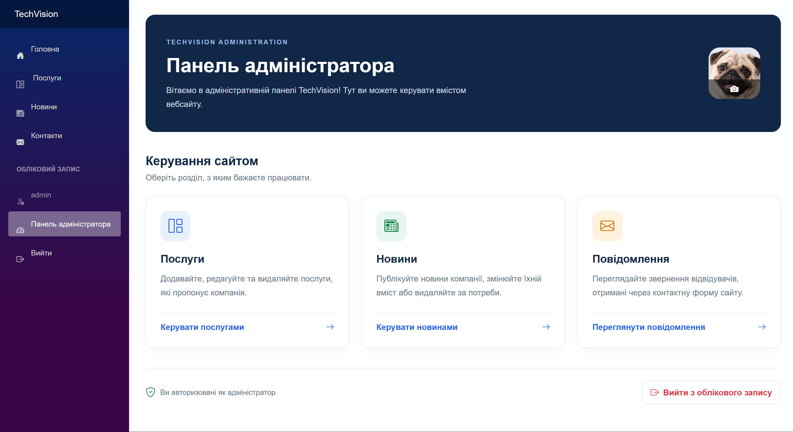
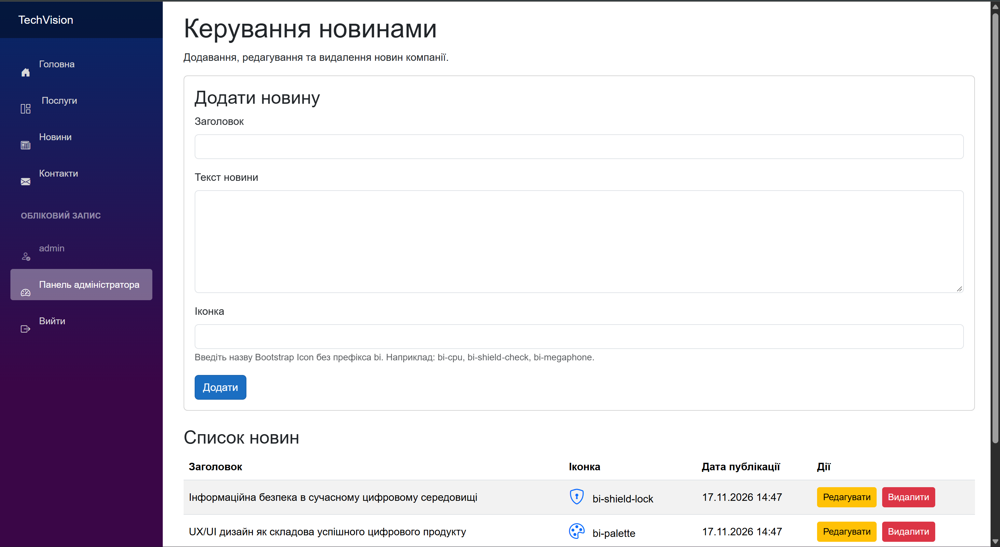
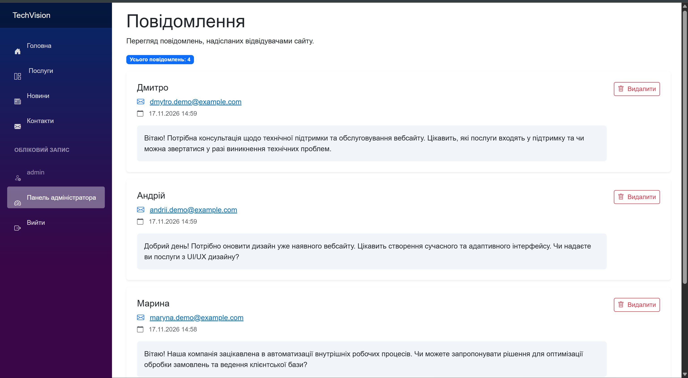
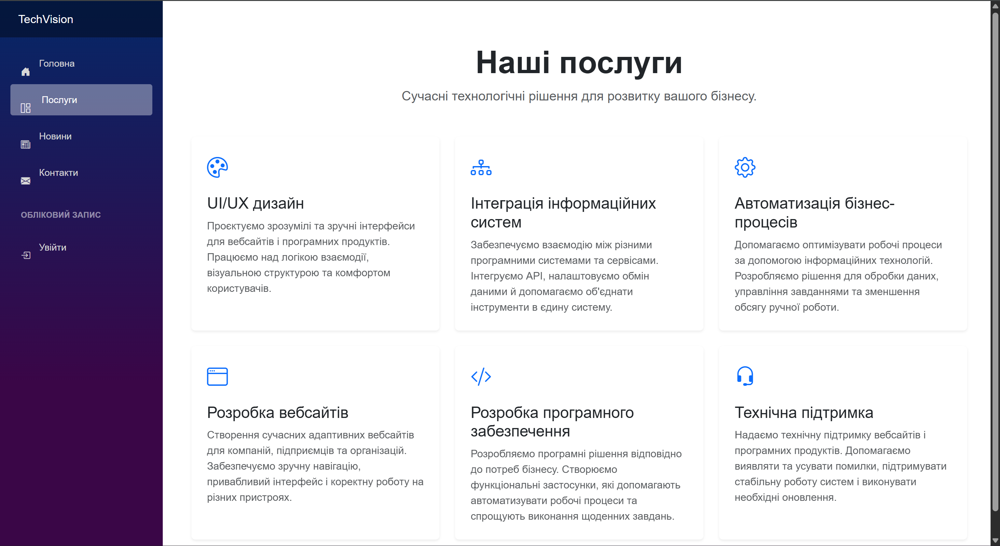
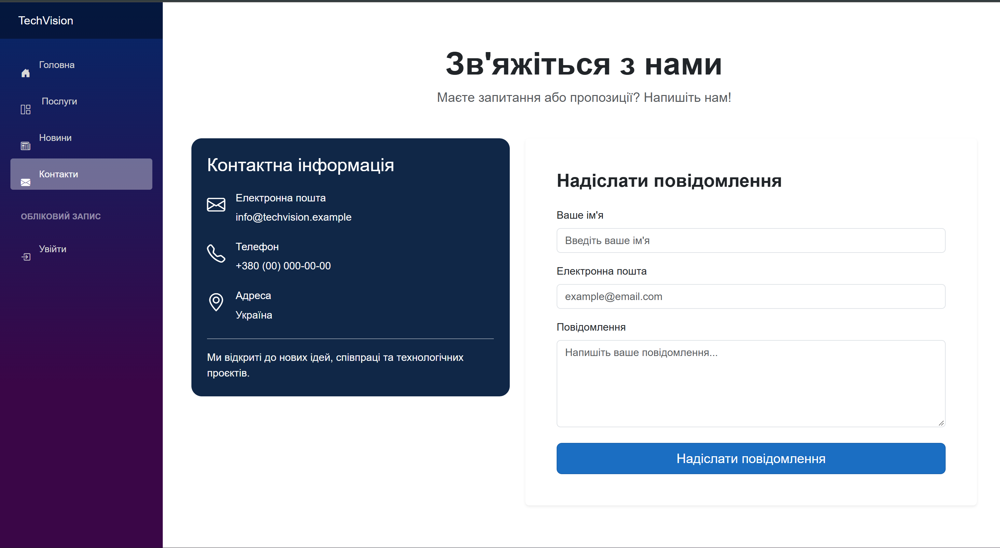

# Інструкція користувача вебсайту TechVision

## 1. Загальні відомості

**TechVision** — корпоративний вебсайт IT-компанії, призначений для ознайомлення відвідувачів із діяльністю компанії, переліком послуг та актуальними новинами, а також для надсилання звернень через контактну форму.

Вебсайт містить дві основні частини:
- **Публічна частина** — доступна всім відвідувачам без авторизації.
- **Адміністративна панель** — призначена для керування вмістом сайту та доступна лише авторизованому адміністратору.

### Основні можливості

- Перегляд інформації про компанію.
- Ознайомлення з переліком послуг.
- Перегляд новин компанії.
- Надсилання повідомлень через контактну форму.
- Керування послугами та новинами.
- Перегляд і видалення повідомлень відвідувачів.
- Налаштування аватара адміністратора.

## 2. Робота з публічною частиною сайту

### 2.1. Головна сторінка

Після відкриття вебсайту користувач потрапляє на головну сторінку. На ній розміщено коротку інформацію про компанію TechVision, основні напрями діяльності та посилання для переходу до інших розділів.

Для навігації використовується верхнє меню сайту.

### 2.2. Сторінка послуг

У розділі «Послуги» відображається перелік послуг, які пропонує компанія. Кожна послуга містить назву, опис та відповідну іконку.

Відвідувач може переглянути доступні пропозиції без реєстрації та авторизації.

### 2.3. Сторінка новин

У розділі «Новини» відображаються інформаційні публікації компанії. Кожна новина містить заголовок, текст, іконку та дату публікації.

Новини доступні для перегляду всім відвідувачам сайту.

### 2.4. Сторінка контактів

Розділ «Контакти» містить контактну інформацію компанії та форму зворотного зв'язку.

Для надсилання повідомлення необхідно:
1. Ввести своє ім'я.
2. Вказати адресу електронної пошти.
3. Ввести текст повідомлення.
4. Натиснути кнопку надсилання.

Після успішного надсилання повідомлення зберігається в базі даних і стає доступним адміністратору в адміністративній панелі.

Під час заповнення форми виконується перевірка обов'язкових полів та коректності електронної пошти.

## 3. Робота з адміністративною панеллю

Адміністративна панель призначена для керування вмістом вебсайту. Доступ до неї має лише авторизований адміністратор.

### 3.1. Вхід до адміністративної панелі

Для входу необхідно:

1. Відкрити сторінку входу адміністратора.
2. Ввести ім'я користувача.
3. Ввести пароль.
4. Натиснути кнопку входу.

Після успішної авторизації користувач переходить до адміністративної панелі.

Якщо введено неправильні облікові дані, система не надасть доступу до адміністративних функцій.

### 3.2. Головна сторінка адміністративної панелі

Після входу адміністратор потрапляє на головну сторінку панелі керування.

На ній доступні основні розділи:
- Керування послугами.
- Керування новинами.
- Перегляд повідомлень відвідувачів.

Також адміністратор може переглянути та змінити власний аватар.

### 3.3. Керування послугами

У розділі керування послугами адміністратор може переглядати наявні записи, додавати нові, редагувати та видаляти послуги.

Для додавання послуги необхідно:
1. Відкрити розділ керування послугами.
2. Заповнити назву та опис послуги.
3. За потреби вказати назву іконки Bootstrap Icons.
4. Зберегти запис.

Для редагування потрібно вибрати відповідну послугу, змінити необхідні дані та зберегти зміни.

Для видалення необхідно скористатися відповідною кнопкою біля потрібного запису.

Усі зміни відображаються в публічному розділі «Послуги».

### 3.4. Керування новинами

У розділі керування новинами адміністратор може створювати, редагувати та видаляти публікації.

Для створення новини необхідно:
1. Відкрити розділ керування новинами.
2. Ввести заголовок.
3. Заповнити текст новини.
4. За потреби вказати назву іконки.
5. Зберегти новину.

Дата публікації встановлюється автоматично під час створення запису.

Створені новини відображаються у публічному розділі «Новини».

### 3.5. Перегляд повідомлень

У відповідному розділі адміністративної панелі відображаються повідомлення, надіслані відвідувачами через контактну форму.

Кожне повідомлення містить ім'я відправника, адресу електронної пошти, текст звернення та дату створення.

Адміністратор може переглядати отримані звернення та видаляти непотрібні повідомлення.

### 3.6. Зміна аватара адміністратора

Для зміни аватара необхідно скористатися відповідним елементом завантаження зображення в адміністративній панелі.

Підтримуються формати PNG, JPG, JPEG та WEBP. Максимальний розмір файлу — 2 МБ.

Після успішного завантаження новий аватар відображається в адміністративній панелі.

### 3.7. Вихід із системи

Для завершення роботи з адміністративною панеллю необхідно натиснути кнопку виходу з облікового запису.

Після цього адміністративна сесія завершується, а користувач повертається до публічної частини вебсайту.

## Скріншоти вебсайту

*Рисунок 1 — Головна сторінка адміністративної панелі.*

*Рисунок 2 — Інтерфейс керування новинами.*

*Рисунок 3 — Перегляд повідомлень від відвідувачів.*

*Рисунок 4 — Публічна сторінка послуг.*

*Рисунок 5 — Сторінка контактів із формою зворотного зв'язку.*